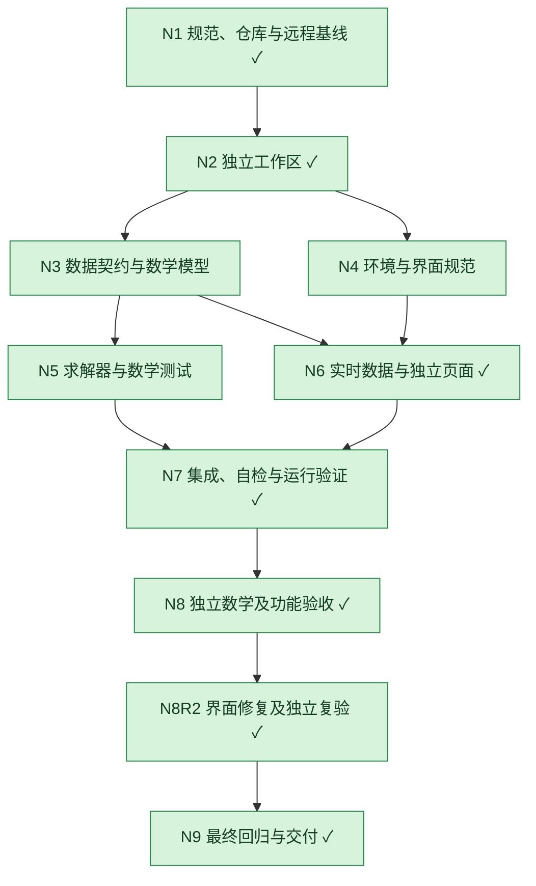

# 账号优先消耗求解 — 权威 DAG

基线 `ae2be0c3c8af76ca859e301e5311d6c0522ec655`；2026-10-30 06:50:58 +08:00 fetch origin/master 成功。
远程 https://github.com/PengZoneLab/cpa-usage-keeper.git 。原工作区 `/Users/ly/Documents/coderepo/cpa-usage-keeper-prompts` master 干净。
分支 `feat/account-optimal-planner-20261030`；工作区 `/Users/ly/Documents/coderepo/cpa-usage-keeper-optimal-planner`。
仓库及适用祖先无 AGENTS.md；不修改原工作区；不提交、推送、合并或发布。

|编号|负责人|依赖|完成标准|状态|产物/证据|轮次|
|---|---|---|---|---|---|---|
|N1|主Agent|无|规范、工作区及远程SHA核实|已完成|本文件基线记录|1|
|N2|主Agent|N1|独立分支worktree，不携带原改动|已完成|worktree list，HEAD固定基线|1|
|N3|主Agent、math_review|N2|模型与实际数据边界明确|已完成|README、types、数学审查|1|
|N4|主Agent|N2|依赖及隔离运行环境可用|已完成|highs1.15.4、生产preview实测；验收后停服释放5196|1|
|N5|主Agent|N3|全计划优化及反例通过|已完成|11开发测试、8独立测试|1|
|N6|data_adapter、planner_ui、主Agent|N3,N4|选账号、只读数据、独立页面可用|已完成|15数据测试、6界面测试、独立UI R3|2|
|N7|主Agent|N5,N6|构建、类型、测试及运行验证通过|已完成|1650前端测试、Go路由、typecheck/lint、真实WASM|2|
|N8|math_review、ui_acceptance|N7|独立验收完整执行，失败可追溯|已完成|数学R1通过；UI R1/R2失败原记录保留|2|
|N8R2|主Agent、ui_acceptance|N8|修复问题后由独立Agent复验通过|已完成|independent-ui-r3.md/log，最终SHA截图|3|
|N9|主Agent|N8R2|最终版本证据绑定、原工作区保留、无非预期修改|已完成|manifest、final-acceptance、git diff --check|1|

## Loop 历史

R1：准备已完成。数学审查发现历史百分比不含model/effort、短窗百分比不能直接与周百分比换算、卡后停用；均纳入显式数据/场景约束。

R2：求解器11项自检和8项独立数学验收通过。数据适配器15项自检通过。135项相关回归通过。页面待浏览器独立验收。Lint发现新页面1条Hook警告，待修复；已有2条保留。

R3：独立UI第1轮未通过。已记录日期边界、全局CSS、历史异步竞态及计算未完成证据；N8R2向后展开修复复验，保留R1失败。

R4：独立UI R3通过，完整DAG全绿。
