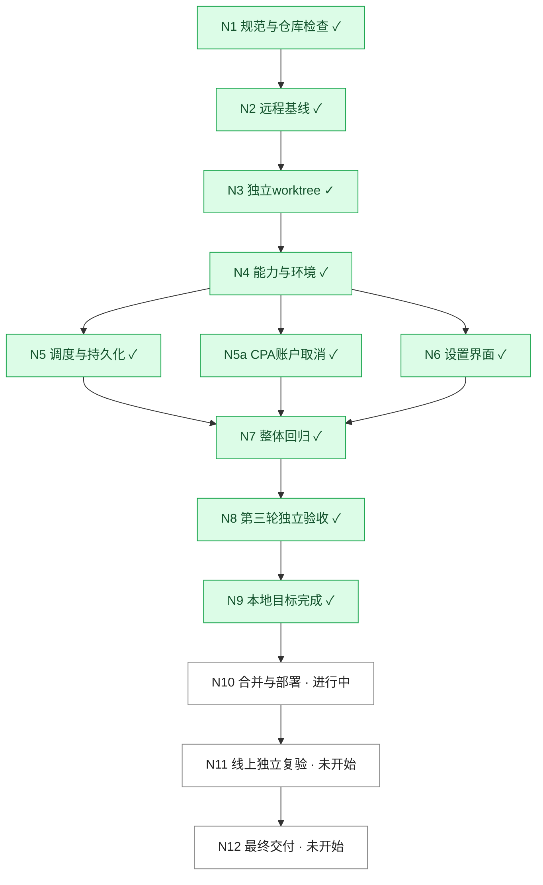

# Codex 重置卡定时任务 DAG

基线：`1ba6e62e7eb4c5e91a38a0dfe27cf32c3bbb33e4`
远程：https://github.com/PengZoneLab/cpa-usage-keeper.git
获取：2026-10-29T16:10:21Z
分支：`feat/codex-reset-card-scheduler-20261030`
工作区：`/Users/ly/Documents/coderepo/cpa-usage-keeper-reset-scheduler`
原 master 与 quota-floor 工作区均干净。无适用 AGENTS.md；遵循 docs/development.md。

## 目标及标准

G1：账户某张 Codex 重置卡定时使用，可修改/取消。G2：账户独立开启到期前 10 分钟使用，每分钟检查。两项默认关闭；任务资格不受 disabled 限制；用卡前停止调度并取消在途，重置后保持停用，保留人工更早截止时间。持久化、同卡去重、不盲目重试未知消费。
用户授权 测试账户A 定时消费、测试账户B 临期消费；生产临期验收不伪造时间。

|编号|名称|负责人|依赖|状态|完成标准 / 证据|轮次|
|---|---|---|---|---|---|---|
|N1|规范与仓库检查|主 Agent|—|已完成|Git 命令验证，固定 SHA 如上|1|
|N2|获取 origin/master|主 Agent|N1|已完成|Git 命令验证，固定 SHA 如上|1|
|N3|独立 worktree|主 Agent|N2|已完成|Git 命令验证，固定 SHA 如上|1|
|N4|环境与上游指定卡能力|主 Agent|N3|已完成|官方 Codex credit_id 源码、线上账户只读回查|1|
|N5|账户策略与持久化调度|主 Agent|N4|待验证|对应目标及版本绑定的验收记录，待补|1|
|N6|账户与单卡设置界面|主 Agent|N4|待验证|对应目标及版本绑定的验收记录，待补|1|
|N7|集成自检与回归|主 Agent|N5,N6|未开始|对应目标及版本绑定的验收记录，待补|1|
|N8|独立验收|acceptance|N7|未开始|对应目标及版本绑定的验收记录，待补|1|
|N9|目标完成|主 Agent|N8|未开始|对应目标及版本绑定的验收记录，待补|1|
|N10|合并主干及线上部署|主 Agent|N9|未开始|对应目标及版本绑定的验收记录，待补|1|
|N11|线上独立复验|acceptance|N10|未开始|对应目标及版本绑定的验收记录，待补|1|
|N12|最终交付|主 Agent|N11|未开始|对应目标及版本绑定的验收记录，待补|1|

|N5a|CPA 账户级取消与结束确认|ui（实现）/acceptance（验收）|N4|进行中|HTTP/SSE/WS、重试、迟到入场隔离；真实结束才 active=0|1|
|R1|独立预审第 1 轮|acceptance|N5|不通过（历史）|四项缺陷，见 issues.md|1|
|F1|定时取消、错误分类与边界修复|主 Agent|R1|待验证|回归覆盖取消重排、未发送重试、晚于T不消费|2|

## 已对齐的时间语义

T 为最晚发起用卡时间；临期策略 T=到期前10分钟。T-3分钟停止新请求；最后一分钟扫描中取消剩余请求、确认本地上游执行全部结束再消费。不得晚于T开始消费。新单卡预约至少提前3分钟；超过截止、取消失败、不确定消费均明确记录。分钟级允许在T前一个扫描周期内执行。上游取消后的计费收尾无法由CPA保证。

## 兼容补丁边界

Keeper 固定基线不变。CPA 附带补丁针对已部署 v8.0.40 精确提交 d946c4fba6fc9a5cfbca1f3d85184d62ad2fb683，作为版本绑定部署产物维护，不将 CPA 其他主干更新混入本任务。源码调查目录 /tmp/cpa-reset-drain-audit-20261030 只读。

|R2|Keeper独立验收第2轮|acceptance|F1|不通过（历史）|分钟执行、重启、停用通过，关闭临期残留任务与双触发资格失败|2|
|F2|关闭策略清理与保留单卡预约|主 Agent|R2|待验证|原子取消纯临期pending、双触发恢复scheduled|3|

N5a 完成证据：[CPA独立验收](independent-cpa.md)，补丁sha256 2fa4a92ee8648aaacf670fefb6655ee3fc951bc8d9507fa1d1a62f965a99afad。Linux兼容容器已验证现有account-rule-router/keeper插件加载；未替换生产。

## 第三轮完成依据

- N5/N5a/N6/N7/N8/N9 当前已完成。N5a依据 independent-cpa.md；N8依据 independent-keeper-r3.md，前两轮不通过保留。
- R3冻结文件清单 version-r3.json；全量Go测试、1608前端测试、类型检查、构建通过。lint只有原有两项警告。
- 独立最终60秒Runner及受影响race通过；截图 ui-r2-scheduled.png/ui-r2-result.png 的界面文件与R3相同。
- N10 进行中；N11/N12 未开始。未将本地通过当作线上完成。
