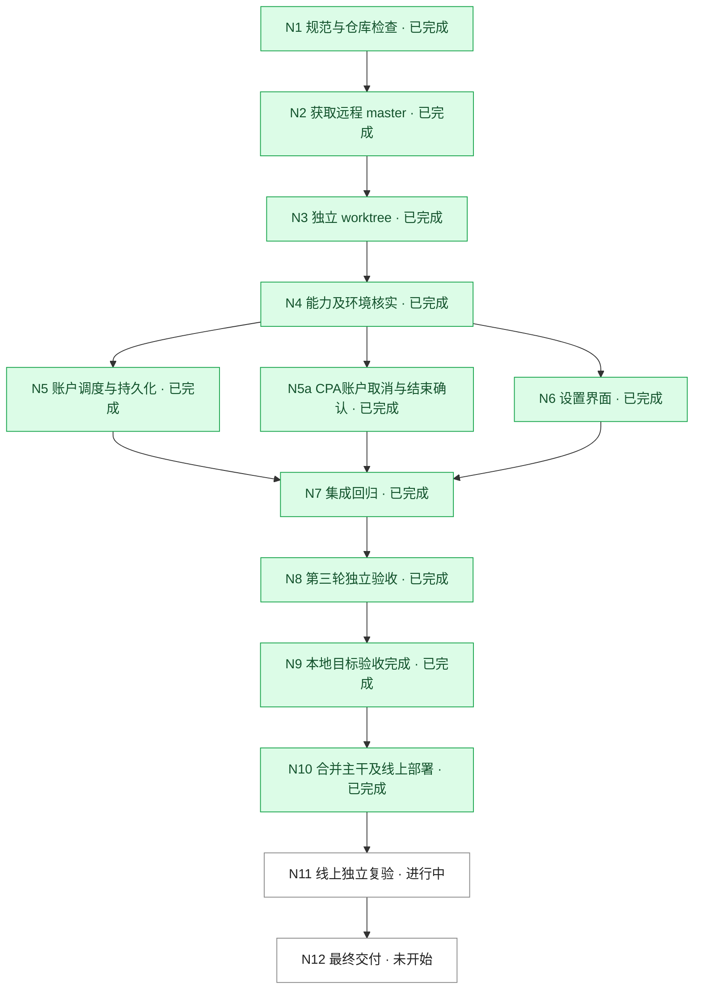

# Codex 重置卡定时任务 DAG

基线：`1ba6e62e7eb4c5e91a38a0dfe27cf32c3bbb33e4`
远程：https://github.com/PengZoneLab/cpa-usage-keeper.git
获取：2026-10-29T16:10:21Z
分支：`feat/codex-reset-card-scheduler-20261030`
工作区：`/Users/ly/Documents/coderepo/cpa-usage-keeper-reset-scheduler`
原 master 与 quota-floor 工作区均干净。无适用 AGENTS.md；遵循 docs/development.md。

## 目标及标准

G1：账户某张 Codex 重置卡定时使用，可修改/取消。G2：账户独立开启到期前 10 分钟使用，每分钟检查。两项默认关闭；任务资格不受 disabled 限制；用卡前停止调度并取消在途，重置后保持停用，保留人工更早截止时间。持久化、同卡去重、不盲目重试未知消费。
用户授权 测试账户A 定时消费、测试账户B 临期消费；生产临期验收不伪造时间。

|编号|名称|负责人|依赖|状态|完成标准与证据|轮次|
|---|---|---|---|---|---|---|
|N1|规范与仓库检查|主 Agent|—|已完成|原工作区干净，docs/development.md|1|
|N2|获取远程 master|主 Agent|N1|已完成|固定基线1ba6e62e|1|
|N3|独立 worktree|主 Agent|N2|已完成|任务分支与路径如上|1|
|N4|能力及环境核实|主 Agent|N3|已完成|官方credit_id源码与只读环境核对|1|
|N5|账户调度与持久化|主 Agent|N4|已完成|version-r3.json / independent-keeper-r3.md|3|
|N5a|CPA账户取消与结束确认|ui / acceptance|N4|已完成|independent-cpa.md|1|
|N6|设置界面|ui / acceptance|N4|已完成|1608项全量前端测试，ui-r2截图|1|
|N7|集成回归|主 Agent|N5,N5a,N6|已完成|self-check-r3.json|3|
|N8|第三轮独立验收|acceptance|N7|已完成|independent-keeper-r3.md|3|
|N9|本地目标验收完成|主 Agent|N8|已完成|所有本地必需关卡通过|3|
|N10|合并主干及线上部署|主 Agent|N9|已完成|c5e8abff已推送；镜像运行、readyz200、备份保留|1|
|N11|线上独立复验|acceptance|N10|进行中|指定卡定时已通过；真实临期窗口等待，私有记录|1|
|N12|最终交付|主 Agent|N11|未开始|等待线上完整证据|1|

## 时间及保护语义

T 为最晚发起用卡时间；临期 T=到期前10分钟。T-3分钟停止新请求；最后一分钟扫描中取消剩余请求、确认本地上游执行全部结束再消费。不得晚于T发起消费。单卡预约至少提前3分钟；超过截止、取消失败、不确定消费均记录，不盲目重试。

## 历史轮次

1. R1 独立预审不通过：取消重排截止、串行慢账户、未发出消费错误、零到期行四项问题。F1已修复并回归。
2. R2 独立验收不通过：关闭临期残留pending、双触发source误跳过。记录 independent-keeper-r2.md；原成功与失败证据均保留。
3. F2修复→R3复验通过：independent-keeper-r3.md。界面与CPA未变，按文件hash继承有效证据。

## 版本与线上边界

Keeper基线固定不变；CPA兼容补丁基于线上v8.0.40提交d946c4fba6fc9a5cfbca1f3d85184d62ad2fb683。主干c5e8abff已推送。线上健康不等于真实卡验收通过；N11仍白色进行中。真实账户/卡ID及运维凭据保存在private/（git与Docker构建均排除）。
